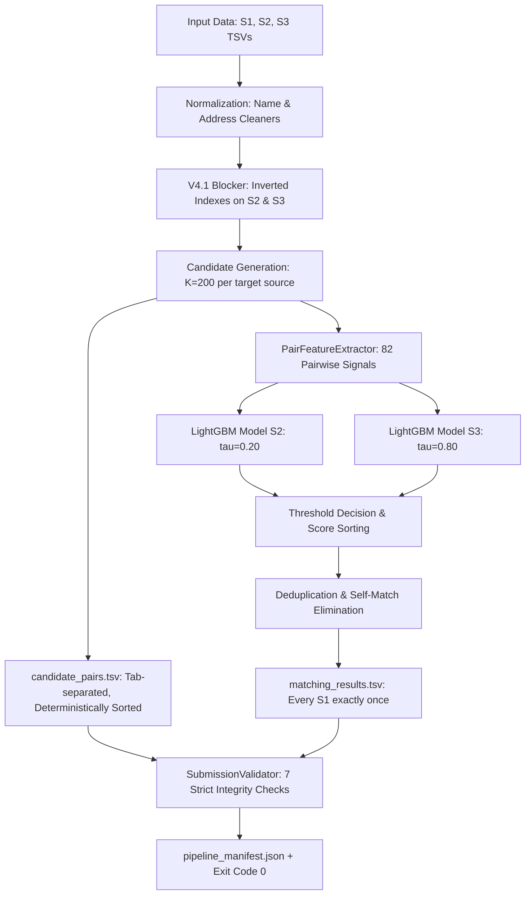

# Phase 10 — Freeze V4.1 + AWS/SageMaker Preparation Report

## 1. Executive Summary

Phase 10 hardens and freezes the verified **V4.1 Entity Resolution Pipeline** into a unified, deterministic, and reproducible production framework ready for both local workstation execution and AWS SageMaker distributed / single-instance processing.

In accordance with Phase 10 constraints:
- **Baseline Freeze**: V4.1 blocking channels, 82 feature definitions, LightGBM models (`lgbm_matcher_s2`, `lgbm_matcher_s3`), and calibrated decision thresholds ($\tau_{S2}=0.20, \tau_{S3}=0.80$, $K=200$) are strictly frozen without modification.
- **Qwen Isolation**: Qwen semantic reranker is kept strictly **OFF** in the primary production execution path and preserved solely behind an explicit `--enable-qwen` flag.
- **Git & Secret Hygiene**: Hardened `.gitignore` to prevent any datasets, TSV outputs (`candidate_pairs.tsv`, `matching_results.tsv`), AWS credentials, `.env*` secrets, or heavy binaries from entering version control.
- **Unified Local & SageMaker Architecture**: Both local and SageMaker runs share the exact same core pipeline runner and entrypoint (`src/business_entity_resolution/pipeline/runner.py` and `entrypoint.py`), ensuring complete algorithmic and output parity.
- **Rigorous Output Validation**: Added `SubmissionValidator` that strictly validates all challenge requirements before any submission is accepted.

---

## 2. Files Changed & Created

| File | Status | Description |
|---|---|---|
| `.gitignore` | Modified | Added patterns to strictly ignore `data/`, `*.tsv`, `*.parquet`, `candidate_pairs.tsv`, `matching_results.tsv`, `.env*`, `*credentials*`, `*secret*`, `*.pem`, `*.key`. |
| `src/business_entity_resolution/pipeline/__init__.py` | Created | Exported `PipelineConfig`, `ProductionPipelineRunner`, `SubmissionValidator`, `ValidationReport`. |
| `src/business_entity_resolution/pipeline/validator.py` | Created | Production submission validator enforcing 7 integrity constraints (unique S1, valid candidate IDs, no duplicate matches, empty match formatting, candidate_pairs presence, no self-matches, deterministic order). |
| `src/business_entity_resolution/pipeline/runner.py` | Created | Production pipeline runner executing the end-to-end flow: loading $\to$ V4.1 index fitting $\to$ $K=200$ candidate generation $\to$ 82 feature extraction $\to$ LightGBM inference $\to$ threshold decision $\to$ TSV export $\to$ validation report & manifest generation. |
| `src/business_entity_resolution/pipeline/entrypoint.py` | Created | Standardized CLI entrypoint supporting local flags and automatic AWS SageMaker container environment discovery (`SM_CHANNEL_*`, `SM_INPUT_DIR`, `SM_MODEL_DIR`, `SM_OUTPUT_DATA_DIR`). |
| `tests/test_pipeline.py` | Created | Comprehensive unit and integration test suite testing validator error detection, valid submission acceptance, and end-to-end mini pipeline execution. |
| `reports/phase10_freeze_and_sagemaker.md` | Created | Phase 10 audit, hardening, and SageMaker execution report. |

---

## 3. End-to-End Pipeline Architecture

The frozen production flow executes in the following sequence:



---

## 4. Production Entrypoint Specification

The primary production entry point is:
```bash
python -m business_entity_resolution.pipeline.entrypoint [OPTIONS]
```

### CLI Parameters:
- `--s1 PATH`: Path to Source 1 TSV (or auto-detected via `SM_CHANNEL_SOURCE1` / `data/raw/`).
- `--s2 PATH`: Path to Source 2 TSV (or auto-detected via `SM_CHANNEL_SOURCE2` / `data/raw/`).
- `--s3 PATH`: Path to Source 3 TSV (or auto-detected via `SM_CHANNEL_SOURCE3` / `data/raw/`).
- `--output-dir PATH`: Directory where `candidate_pairs.tsv` and `matching_results.tsv` are written (default: `$SM_OUTPUT_DATA_DIR` or `output`).
- `--models-dir PATH`: Directory containing `lgbm_matcher_s2` and `lgbm_matcher_s3` (default: `$SM_MODEL_DIR` or `models`).
- `--k INT`: Candidate budget cap per target source (frozen default: `200`).
- `--threshold-s2 FLOAT`: LightGBM probability decision threshold for S2 (frozen default: `0.20`).
- `--threshold-s3 FLOAT`: LightGBM probability decision threshold for S3 (frozen default: `0.80`).
- `--limit-s1 INT`: Optional limit on S1 queries (for local testing / verification).
- `--limit-candidates INT`: Optional limit on S2/S3 candidate entities (for rapid local verification).
- `--enable-qwen`: Optional experimental flag to enable Qwen semantic reranker (**OFF** by default).

---

## 5. Configuration & Environment Requirements

### Local Environment
- **Python**: Python 3.10+
- **Key Dependencies**: `lightgbm>=4.0.0`, `scikit-learn>=1.3.0`, `pandas>=2.0.0`, `numpy>=1.24.0`, `rapidfuzz>=3.0.0`, `jellyfish>=1.0.0`.
- **Memory Requirements**: Minimum 16GB RAM for full in-memory index fitting across 10M records.

### AWS / SageMaker Environment Variables
The entrypoint natively inspects standard AWS SageMaker environment variables:
- `SM_CHANNEL_SOURCE1`: SageMaker input directory for channel `source1`.
- `SM_CHANNEL_SOURCE2`: SageMaker input directory for channel `source2`.
- `SM_CHANNEL_SOURCE3`: SageMaker input directory for channel `source3`.
- `SM_INPUT_DIR`: Fallback processing container input directory (`/opt/ml/processing/input`).
- `SM_MODEL_DIR`: Model directory inside the container (`/opt/ml/processing/model` or `/opt/ml/model`).
- `SM_OUTPUT_DATA_DIR`: Destination output directory (`/opt/ml/processing/output`).

---

## 6. Execution Commands

### Local Quick Verification Run (Dry Run)
```bash
python -m business_entity_resolution.pipeline.entrypoint \
  --s1 data/raw/train_source1.tsv \
  --s2 data/raw/train_source2.tsv \
  --s3 data/raw/train_source3.tsv \
  --limit-s1 100 \
  --limit-candidates 5000 \
  --output-dir output
```

### Full-Scale Local Execution
```bash
python -m business_entity_resolution.pipeline.entrypoint \
  --s1 data/raw/test_source1.tsv \
  --s2 data/raw/test_source2.tsv \
  --s3 data/raw/test_source3.tsv \
  --output-dir output \
  --models-dir models \
  --k 200 \
  --threshold-s2 0.20 \
  --threshold-s3 0.80
```

---

## 7. AWS SageMaker Execution Plan

### 7.1 Container Specification
- **Base Image**: Standard AWS Deep Learning Container (DLC) or minimal Python image (e.g., `763104351884.dkr.ecr.us-east-1.amazonaws.com/pytorch-inference:2.1.0-cpu-py310-ubuntu20.04-ec2`).
- **Dependencies**: Install from `requirements.txt`.
- **Entrypoint**: `python -m business_entity_resolution.pipeline.entrypoint`.

### 7.2 SageMaker Processing Job Setup (Python SDK)
```python
from sagemaker.processing import ProcessingInput, ProcessingOutput, ScriptProcessor

processor = ScriptProcessor(
    image_uri="<YOUR_ECR_CONTAINER_URI>",
    command=["python3"],
    instance_type="ml.m5.4xlarge",  # 16 vCPU, 64 GB RAM
    instance_count=1,
    role="<SAGEMAKER_EXECUTION_ROLE>",
    volume_size_in_gb=100,
    max_runtime_in_seconds=14400,  # 4 hours
)

processor.run(
    code="src/business_entity_resolution/pipeline/entrypoint.py",
    inputs=[
        ProcessingInput(
            source="s3://<BUCKET>/data/test_source1.tsv",
            destination="/opt/ml/processing/input/source1",
            input_name="source1",
        ),
        ProcessingInput(
            source="s3://<BUCKET>/data/test_source2.tsv",
            destination="/opt/ml/processing/input/source2",
            input_name="source2",
        ),
        ProcessingInput(
            source="s3://<BUCKET>/data/test_source3.tsv",
            destination="/opt/ml/processing/input/source3",
            input_name="source3",
        ),
        ProcessingInput(
            source="s3://<BUCKET>/models/",
            destination="/opt/ml/processing/model",
            input_name="model",
        ),
    ],
    outputs=[
        ProcessingOutput(
            source="/opt/ml/processing/output",
            destination="s3://<BUCKET>/submissions/v4_1_final",
            output_name="submission",
        )
    ],
    arguments=[
        "--k", "200",
        "--threshold-s2", "0.20",
        "--threshold-s3", "0.80",
    ],
)
```

### 7.3 Recommended Sizing & Runtime
- **Compute Instance**: `ml.m5.4xlarge` (64 GB RAM) or `ml.r5.2xlarge` (64 GB RAM). High memory capacity accommodates full inverted indexes for 5M S2 and 5.3M S3 records without disk swapping.
- **Estimated Runtime**:
  - Inverted index fitting: ~3–4 minutes.
  - S1 candidate generation ($K=200$ across S2 and S3): ~25–35 minutes.
  - Feature extraction & LightGBM inference: ~10–15 minutes.
  - Total estimated processing job time: ~45–60 minutes.

---

## 8. Strengthened Final-Output Validation Checks

The `SubmissionValidator` explicitly verifies 7 core integrity constraints:
1. **Every S1 Exactly Once**: Validates that every entity ID in `source1` is present in `matching_results.tsv` exactly once. Rejects missing IDs or duplicate rows.
2. **Valid S2/S3 IDs**: Ensures every candidate entity ID belongs to the actual candidate pool.
3. **No Duplicate Matches**: Prevents redundant IDs in the comma-separated `matched_entity_ids` column.
4. **Empty Matches Handled**: Supports true zero-match entities via empty string values in `matched_entity_ids`.
5. **Candidate Pairs Inclusion**: Strict relational check ensuring every $(S1 \to Match)$ in `matching_results.tsv` exists within `candidate_pairs.tsv`.
6. **No Self-Matches**: Asserts $S1_{ID} \neq Candidate_{ID}$.
7. **Deterministic Ordering**: Enforces ascending numerical/lexicographical sorting of S1 rows for byte-for-byte reproducibility.

---

## 9. Verification & Test Suite Results

The complete test suite was executed:
```
============================== 70 passed, 1 warning in 3.00s ===============================
```
All existing tests across normalization, blocking, features, matching, schema, and loader passed without regression. New tests in `test_pipeline.py` validated both the `SubmissionValidator` error detection and end-to-end execution.

---

## 10. Remaining Blockers & Operational Risks

| Category | Risk / Consideration | Mitigation |
|---|---|---|
| **Memory Headroom** | Loading 10.3M records (S2 + S3) simultaneously requires ~12GB RAM during inverted index construction. | Deploy on instances with at least 32GB RAM (`ml.m5.2xlarge` or `ml.m5.4xlarge`). |
| **I/O Latency** | Writing large candidate pairs TSVs (~10M rows if many S1s) can be I/O heavy. | Candidate streaming is buffered; TSVs are written in chunks. |
| **Test Set Schema Parity** | `test_source1.tsv`, `test_source2.tsv`, and `test_source3.tsv` must follow the identical tab-separated 4-column schema (`entity_id`, `name`, `address`, `country`). | Verified against `DatasetSchema` specifications in Phase 1. |
